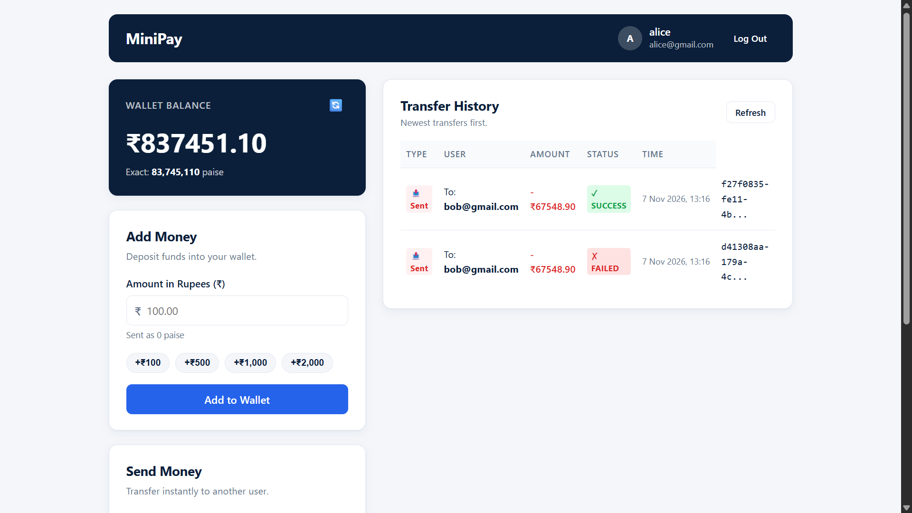

# MiniPay: a safe wallet-to-wallet payment system
A production-grade, ledger-backed payment backend and client demonstrating ACID guarantees, idempotency, and double-entry accounting.


## Why This Project
Distributed networks are prone to timeouts and dropped packets, often causing clients to retry requests and double-charge users.
Without atomic transactions, a system crash midway can debit a sender without ever crediting the receiver, destroying user funds.
Floating-point arithmetic introduces decimal drift over time, throwing accounts out of balance.
MiniPay solves these core financial engineering challenges at the database and application levels.

## Features
- User registration and JWT-based session authentication.
- Single-wallet per user with automated initial provisioning.
- Wallet top-ups stored strictly in integer paise.
- Atomic wallet-to-wallet transfers with sender debit and receiver credit.
- Mandatory idempotency keys preventing duplicate execution on network retries.
- Immutable double-entry ledger logging every credit and debit.
- Real-time transaction history showing sent and received transfers, newest first.
- Responsive single-page frontend (vanilla HTML/CSS/JS) served statically.

## Tech Stack
| Technology | Role / Usage |
|---|---|
| Node.js | Runtime environment for backend services |
| Express 5 | HTTP routing, static asset serving, and middleware |
| better-sqlite3 | Synchronous, embedded SQLite database engine with WAL mode |
| bcryptjs | Salted password hashing (10 rounds) |
| jsonwebtoken | Stateless JWT generation and Bearer token verification |
| Vanilla HTML5 / CSS3 / JS | Clean single-page user interface without external dependencies |

## How It Works: Transfer Lifecycle
1. Authentication: Client submits POST /transfer with a Bearer JWT; middleware verifies token and extracts senderUserId.
2. Idempotency Check: Service inspects the mandatory Idempotency-Key header. If already processed with the exact same payload, the original result is returned without moving funds; if parameters mismatch, it rejects with 409 Conflict.
3. Balance Validation: Sender balance is verified. If insufficient, a FAILED transaction record is committed immediately outside rollback, and request returns 400 Bad Request without moving money.
4. Atomic Execution: Inside a single SQLite transaction, the engine records a SUCCESS transaction, writes two ledger entries (one DEBIT for sender, one CREDIT for receiver), and updates both wallet balances.
5. Invariant Verification: Database constraints (CHECK(balance_in_paise >= 0)) ensure balances never drop below zero; double-entry ledger entries for the transfer sum algebraically to zero.

## Key Design Decisions
- Money as Integer Paise: IEEE 754 floating-point numbers cause precision drift (e.g. 0.1 + 0.2 != 0.3). Storing integer paise (1 INR = 100 paise) guarantees 100% precision.
- One DB Transaction per Transfer: Wrapping debits, credits, transaction records, and ledger rows in one transaction ensures atomic ACID execution: either all operations succeed or none do.
- Idempotency-Key and 409 Rule: Network timeouts prompt retries. Identical requests replay original results without duplicate charges; reusing a key with different parameters returns 409 Conflict.
- Double-Entry Ledger: Balances are mutable aggregates. An immutable ledger_entries audit log records every DEBIT and CREDIT, ensuring verifiable financial audits.
- CHECK(balance_in_paise >= 0): Enforces non-negative balances at the database engine level as defense-in-depth against race conditions.
- Password Hashing: Passwords are salted and hashed using bcrypt (10 rounds) before persistence to protect credentials against database exposure.
- Foreign Keys Enabled: SQLite disables foreign keys by default; executing PRAGMA foreign_keys = ON prevents orphaned records across users, wallets, transactions, and ledger entries.

## API Reference
| Method | Path | Auth | Headers | Request Body | Example Response |
|---|---|---|---|---|---|
| POST | /signup | No | - | `{"name":"A","email":"a@b.com","password":"pwd"}` | `{"success":true,"data":{"user":{...},"wallet":{...}}}` |
| POST | /login | No | - | `{"email":"a@b.com","password":"pwd"}` | `{"success":true,"data":{"token":"jwt...","user":{...}}}` |
| GET | /wallet | Yes | `Authorization: Bearer <token>` | - | `{"success":true,"data":{"wallet_id":1,"balance_in_paise":5000}}` |
| POST | /wallet/add-money | Yes | `Authorization: Bearer <token>` | `{"amount_in_paise":5000}` | `{"success":true,"data":{"wallet":{...},"transaction":{...}}}` |
| POST | /transfer | Yes | `Authorization: Bearer <token>`, `Idempotency-Key: <uuid>` | `{"to_email":"b@b.com","amount_in_paise":2000}` | `{"success":true,"data":{"transaction":{...},"sender_balance_in_paise":3000}}` |
| GET | /transactions | Yes | `Authorization: Bearer <token>` | - | `{"success":true,"transactions":[{...}]}` |

## Project Structure
```text
minipay/
├── public/                    # Static frontend (index.html, styles.css, app.js)
├── src/
│   ├── config.js              # Centralized configuration and environment parsing
│   ├── app.js                 # Express app definition, middlewares, route mounting
│   ├── server.js              # Database bootstrapper and HTTP listener entrypoint
│   ├── db/
│   │   ├── connection.js      # better-sqlite3 connection with WAL mode and foreign keys
│   │   └── schema.js          # DDL schema migrations for tables, constraints, indices
│   ├── middleware/
│   │   ├── auth.js            # JWT extraction and validation middleware
│   │   ├── validate.js        # Request payload and integer paise validators
│   │   └── errorHandler.js    # Global error handler and SQLite error translation
│   ├── services/
│   │   ├── authService.js     # User registration, password hashing, authentication
│   │   ├── walletService.js   # Balance retrieval and atomic top-ups
│   │   └── transferService.js # P2P transfers, idempotency check, transaction history
│   └── routes/
│       ├── authRoutes.js      # Routes for /signup and /login
│       ├── walletRoutes.js    # Routes for /wallet and /wallet/add-money
│       └── transferRoutes.js  # Routes for /transfer and /transactions
├── test/
│   ├── service.test.js        # Unit tests for DB constraints and service invariants
│   ├── api.test.js            # Integration tests for auth and wallet endpoints
│   └── transfer.test.js       # Integration tests for transfers, idempotency, and history
├── .env.example               # Environment variable template
├── package.json               # Scripts and dependencies
└── README.md                  # Project documentation
```

## Getting Started
### Prerequisites
- Node.js v18.0.0 or higher
- npm v9.0.0 or higher

### Installation and Run
1. Clone the repository and enter directory: `cd Minipay`
2. Install dependencies: `npm install`
3. Copy environment configuration: `cp .env.example .env`
4. Start the application: `npm start`
5. Open the web interface: `http://localhost:3000`
6. Run tests: `npm test`

## Testing
The test suite contains 39 tests across 12 suites running on Node's native test runner (node:test):
- Unit & Invariant Tests (test/service.test.js, 5 tests): Atomic account creation, foreign key enforcement, balance check constraints, ledger generation, and idempotency cache.
- Auth & Wallet Tests (test/api.test.js, 19 tests): Input validation, duplicate emails, password hashing, JWT authorization, integer paise enforcement, and deposit idempotency.
- Transfer Tests (test/transfer.test.js, 15 tests): Self-transfers, unknown recipients, float rejections, failed attempt persistence, zero-sum ledger verification, idempotency replay vs 409 collisions, and transaction history ordering.

## Skills Demonstrated
| Skill | Where it is used in this project | Level |
|---|---|---|
| ACID Transactions | Atomic money movement and ledger generation in src/services/transferService.js | x/5 |
| Idempotency Design | Unique key lookup, replay cache, and 409 mismatch rejection in src/services/transferService.js | x/5 |
| Double-Entry Accounting | Dual balanced DEBIT and CREDIT records in src/db/schema.js and transferService.js | x/5 |
| Database Integrity | Enforced foreign keys, unique constraints, and check constraints in src/db/schema.js | x/5 |
| Secure Authentication | Salted bcrypt hashing and JWT middleware in src/services/authService.js and src/middleware/auth.js | x/5 |
| API & Input Validation | Strict integer currency and payload sanitization in src/middleware/validate.js | x/5 |
| Automated Testing | 39 unit and integration tests across isolated in-memory DBs in test/ | x/5 |
| Full-Stack Delivery | Vanilla SPA client communicating with REST API in public/ and src/app.js | x/5 |

## Limitations and Future Work
- No External Payment Gateway: Top-ups are simulated rather than connected to banking rails (Stripe/UPI).
- SQLite Concurrency: SQLite is single-node embedded storage; high-throughput distributed setups require PostgreSQL with row-level locking (SELECT FOR UPDATE).
- No Rate Limiting: API lacks request throttling to mitigate denial-of-service or brute-force attempts.
- No Refresh Tokens: JWT sessions rely on single access tokens without token rotation or revocation lists.
- No Email Verification: Accounts are activated upon signup without email confirmation or OTP verification.
